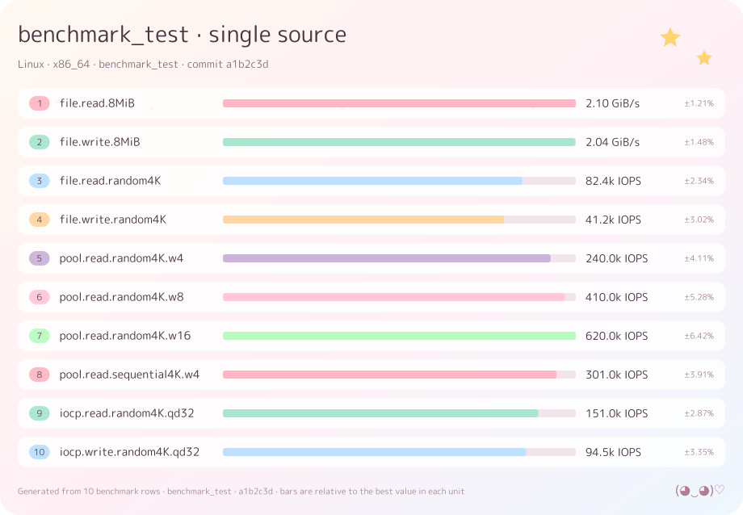

# Benchcat

Render benchmark results as a self-contained SVG card for a README.

A personal tool, published as-is. It reads what a benchmark runner already writes, draws one SVG, and
stops there — committing it, uploading it, or commenting it on a pull request is your workflow's job.



## Install

```bash
cargo install --path .
```

Or download a prebuilt binary from Releases (`benchcat-<target>.tar.gz`, checksums in `SHA256SUMS`).

A TrueType/OpenType face is required; `fonts/` ships an OFL catalogue (see [Fonts](#fonts)):

```bash
benchcat render bench.jsonl -o assets/bench.svg --font quicksand
benchcat render bench.jsonl -o assets/bench.svg --font-file MyFont.ttf
```

## Quick start

```bash
benchcat render bench.jsonl       -o assets/bench.svg                 # benchmark_test JSONL
benchcat render report.json       -o assets/bench.svg                 # canonical JSON
benchcat render results.csv       -o assets/bench.svg                 # CSV
benchcat render target/criterion  -o assets/bench.svg --format criterion
benchcat render bench.json        -o assets/bench.svg --format hyperfine
```

Same inputs produce the same bytes, so a committed SVG only changes when the data does:

```bash
git diff --quiet -- assets/bench.svg || git commit -am "bench: refresh [skip ci]"
```

## Input

`--format` accepts `auto` (default), `json`, `jsonl`, `csv`, `benchmark_test`, `criterion` and
`hyperfine`. Directories are walked recursively; criterion's `report/` folder is skipped.

Canonical shape, `benchcat/report@1`:

```jsonc
{
  "schema": "benchcat/report@1",
  "meta": {
    "tool": "benchmark_test",
    "tool_version": "0.9.1",
    "commit": "cd5cd87",
    "platform": { "os": "Windows", "arch": "x86_64", "cpu": "Ryzen 9 7950X", "cores": 32 }
  },
  "benchmarks": [{
    "id": "file.read.8MiB",          // stable key: matching, ordering, comparisons
    "group": "File I/O",
    "label": "Sequential read",      // display only
    "note": "8 MiB blocks · 1 GiB file",
    "unit": "B/s",                   // a dimension, not a decoration
    "value": 2254857830,
    "direction": "higher",           // "lower" for latency
    "params": { "block": "8MiB" },   // structured, available to row templates
    "stats": { "rme_pct": 1.21, "samples": 5 },
    "deterministic": false
  }]
}
```

Units carry a dimension (`B/s`, `IOPS`, `ns/op`, `instr`, `×`), so values are formatted from the data.
Bars are scaled inside one dimension, and `direction: "lower"` inverts them so a longer bar always
means better.

### criterion

```bash
benchcat render target/criterion -o assets/bench.svg --format criterion
```

Walks `<bench>/new/estimates.json`, reads the sibling `benchmark.json` for `full_id` and `throughput`,
and turns `Bytes`/`Elements` throughput into `B/s`/`ops/s` (`ns/op`, lower-is-better otherwise). The
95 % confidence interval becomes the ±RME column.

### hyperfine

```bash
benchcat render bench.json -o assets/bench.svg --format hyperfine
```

Reads `--export-json` v2 (and the legacy v1 shape), using the wall-clock mean with lower-is-better;
seconds are formatted as ms/µs.

## CLI

| Flag | Meaning |
|---|---|
| `INPUT...` | Files or directories |
| `--out <FILE>` | Output path; `-` writes to stdout |
| `--format <FORMAT>` | `auto`, `json`, `jsonl`, `csv`, `benchmark_test`, `criterion`, `hyperfine` |
| `--config <FILE>` | Defaults to `./benchcat.toml` when present |
| `--font <NAME>` | Family inside `./fonts` (or `BENCHCAT_FONT_DIR`), e.g. `quicksand` |
| `--font-file <FILE>` | Explicit TTF/OTF path |
| `--title` / `--subtitle` / `--footer` | Override the three text lines |
| `--width <PX>` | Canvas width (default 920) |
| `--min-height <PX>` | Keep the card at least this tall |
| `--max-rows <N>` | Render only the first N rows |
| `--theme <NAME>` | `pastel` or `dark` |
| `--stdout` | Also print the SVG |

`benchcat formats` lists the accepted format names.

Logging is off unless you opt in with `--log info` (or `--log debug`); it writes stage timings to stderr.
The SVG on stdout (`-o -`) is never mixed with logs, and CI does not treat stderr output as failure.

## Config

`benchcat.toml` is discovered from the working directory; `--config` overrides it.

```toml
[font]
family = ["mplus-rounded"]  # one stem, "a,b", or ["a","b"]
enable_guaranteed_font = false   # opt-in per-character fallback; see below
enable_system_font = false        # opt-in family lookup in installed system fonts

[render]
title = "blit benchmarks"
subtitle = "{platform|local} · {tool} {tool_version} · commit {commit}"
footer = "Generated from {rows} rows"
width = 920
min_height = 0
theme = "pastel"          # or "dark"
kaomoji = "(◕‿◕)♡"
max_rows = 12
bar_scale = "row"          # row | source | global (multi-source only)
bar_curve = "linear"       # linear | log (multi-source only)
missing = "skip"           # skip | placeholder (multi-source only)

[[series]]
label = "Linux x64"
input = "bench-linux.jsonl"
color = "#7FD1B9"

[[series]]
label = "Windows x64"
input = "bench-windows.jsonl"
color = "#8CB8F0"
```

`family` accepts a single stem (`"mplus-rounded"`), a comma-separated string (`"mplus-rounded,
zcool-kuaile"`) or a list (`["mplus-rounded", "zcool-kuaile"]`); entries are tried in order, so old
single-string configs are unchanged.

`enable_guaranteed_font = false` keeps the original single-face behaviour, so existing configs and
cards are unchanged. When it is `true`, the configured face is tried first and characters it lacks come
from a fixed list: our `fonts/` catalogue (`mplus-rounded`, `zen-maru-gothic`, `zcool-kuaile`,
`quicksand`) and then a short system list, at most four faces in total. The list is not configurable. If
the configured face is missing or unreadable, the first guaranteed face becomes the primary. Runs fully
covered by the primary face keep byte-identical output; only runs that actually use a fallback switch to
per-glyph scaling.

`enable_system_font = false` (default) keeps family lookup inside the repository. When it is `true`, a
family can also match an installed system face, matched by name (case and punctuation insensitive) and
including TrueType/OpenType collections. Repository fonts still win, and the option is off by default so
cards stay reproducible across machines.

For CI and other automated builds, keep both `enable_guaranteed_font` and `enable_system_font` off: they
can depend on fonts installed on the runner. Use the repository catalogue (`font`) or `font_file` instead.

Two or more `[[series]]` switch to the comparison layout: one row per operation, one bar per source, a
legend, and one value per bar. Bars are linear and scaled to the row's own best value by default
(`bar_scale = "row"`); `bar_curve = "log"` compresses wide ranges, `bar_scale = "source"` compares each
source against its own best across rows, and `bar_scale = "global"` uses one reference per unit family
for the whole card. Single-source cards keep the log scale against the best row of the unit family.

When a row is missing a source, `missing = "skip"` (default) draws no bar and the row is shorter;
`missing = "placeholder"` keeps the slot and prints `—`.

### Row mapping

`[[row]]` renames rows, overrides units and transforms values. Rules apply in order, and matching rows
take the rule's position in the card.

```toml
[[row]]
id = "file.read.8MiB"
label = "Sequential read"
note = "8 MiB blocks · 1 GiB file"

[[row]]
match = '^pool\.read\.random4K\.w(\d+)$'
label = "Pool read · $1 workers"
note = "4 KiB · batch 32"
value = "value * $1 * 32"
unit = "IOPS"
group = "Thread pool"
```

- `id` is an exact match; `match` is a regex whose groups become `$1`… in templates and values.
- `label`/`note` support `$1` captures and `{param}` placeholders; an empty `note` clears it.
- `value` is a small expression: numbers, `value`, `$1`…, `+ - * /`, parentheses and
  `min`/`max`/`abs`/`log10`/`sqrt`/`round`.
- `group` (or a `group` field on the input) puts the row under a section heading; rows sharing a group
  are drawn together, in the order the group first appears.
- `only_matched = true` under `[render]` drops unmatched rows; the default appends them.

### Placeholders

`{commit}`, `{commit:full}`, `{branch}`, `{tool}`, `{tool_version}`, `{tool:full}`, `{platform}`,
`{os}`, `{os_version}`, `{arch}`, `{cpu}`, `{cores}`, `{ram_gib}`, `{runner}`, `{rows}`, `{font}`.

Values come from the input document plus `GITHUB_SHA`, `RUNNER_OS` and `RUNNER_ARCH` when present.
`{key|fallback}` renders the fallback when the value is empty; `{{` is a literal `{`.

## Fonts

`fonts/` holds an OFL-only catalogue; pick one with `[font] family` or `--font`. The full table —
coverage, file size and a specimen for every family — is on the
[Fonts wiki page](https://github.com/unk-404/benchcat/wiki/Fonts).

Each family ships its `-OFL.txt` next to the binary. The generated specimens are committed under
`assets/fonts/<file-stem>.svg`; CI mirrors them to the wiki (one heading per family, images linked from
this repository). Specimens draw every glyph the face cannot provide as a small pastel cat.

## Examples

| Figure | Shows |
|---|---|
| [`01-basic.svg`](assets/examples/01-basic.svg) | single source, mixed units, RME column |
| [`02-comparison.svg`](assets/examples/02-comparison.svg) | same operations, three platforms, legend |
| [`03-units.svg`](assets/examples/03-units.svg) | `B/s`, `IOPS`, `ns/op`, `instr` from their units |
| [`04-min-height.svg`](assets/examples/04-min-height.svg) | `min_height` |
| [`05-dark.svg`](assets/examples/05-dark.svg) | `theme = "dark"` |
| [`06-max-rows.svg`](assets/examples/06-max-rows.svg) | `max_rows` |
| [`07-dynamic-height.svg`](assets/examples/07-dynamic-height.svg) | height follows the rows |
| [`08-cjk.svg`](assets/examples/08-cjk.svg) | Japanese labels |
| [`09-notes.svg`](assets/examples/09-notes.svg) | notes and structured params |
| [`10-criterion.svg`](assets/examples/10-criterion.svg) | `--format criterion` |
| [`11-hyperfine.svg`](assets/examples/11-hyperfine.svg) | `--format hyperfine` |
| [`12-rows.svg`](assets/examples/12-rows.svg) | `[[row]]` mapping |
| [`13-sections.svg`](assets/examples/13-sections.svg) | `group` fields become section headings |
| [`14-missing.svg`](assets/examples/14-missing.svg) | a missing source is skipped and the row shrinks |
| [`15-bar-scale.svg`](assets/examples/15-bar-scale.svg) | `bar_scale = "global"` |
| [`16-font-fallback.svg`](assets/examples/16-font-fallback.svg) | English only → Japanese fallback → Chinese/Korean → Russian (Noto Sans) |

```bash
cargo run --example gallery                      # SVGs into assets/examples/
cargo run --example gallery -- --only 14 --png    # one example, plus a PNG preview
cargo run --example gallery -- --list             # example names
cargo run --example specimen -- --font quicksand   # one specimen
cargo run --example specimen -- --list            # font stems
```

## GitHub Action

The action installs the right binary (cached, checksum-verified) and runs one render. It does not touch
git, tokens or pull requests.

```yaml
- uses: unk-404/benchcat@master
  id: bench
  with:
    input: target/criterion
    format: criterion
    out: assets/benchmarks.svg
    config: benchcat.toml
```

| Input | Default | Meaning |
|---|---|---|
| `input` | — | Files or directories, space or newline separated |
| `format` | `auto` | Same values as `--format` |
| `config` | — | `benchcat.toml` (auto-discovered when omitted) |
| `out` | `assets/benchmarks.svg` | Output path |
| `font` | — | One or more catalogue families, comma separated, e.g. `quicksand,zcool-kuaile` |
| `font_file` | — | Custom TTF/OTF; the bundled catalogue needs no file |
| `version` | `auto` | Release tag; `auto` follows the action ref, else `latest` |
| `tool_path` | — | Use an existing binary, no download |

The action carries the OFL font catalogue and points the renderer at it at runtime: do not add,
download or commit fonts. Leave `font` empty for `mplus-rounded`, or name a catalogue family. Use
`font_file` only for a custom face you already have.

Outputs: `svg` and `bytes`. The step summary records both. The binary is downloaded from this action's
own repository (`GITHUB_ACTION_REPOSITORY`), not the caller's, and its checksum is verified against the
release. Set `BENCHCAT_RELEASE_BASE` to a mirror when GitHub release downloads are slow.

Ready-made workflows are in [`templates/`](templates/):

- [`rust-criterion.yml`](templates/rust-criterion.yml)
- [`dart-benchmark-test.yml`](templates/dart-benchmark-test.yml)
- [`hyperfine-matrix.yml`](templates/hyperfine-matrix.yml)

## For agents

- [`skills/benchcat/SKILL.md`](skills/benchcat/SKILL.md) — integration: one action step,
  inputs, formats, config, verification, failure modes.
- [`skills/benchcat-dev/SKILL.md`](skills/benchcat-dev/SKILL.md) — development: module map,
  layout engine, determinism rules, fonts, gallery and release workflow.

## Releases

Tags are `vYYYY.MM.DD-<short-sha>` (no semantic versions). Each release carries the six target
archives, `SHA256SUMS`, `benchcat-assets.tar.gz` (gallery and specimens), and SLSA attestations.
The complete TTF catalogue is also published as `benchcat-fonts.7z` on the rolling
[`fonts-latest` prerelease](https://github.com/unk-404/benchcat/releases/tag/fonts-latest); it is
deliberately not marked latest, so the action still resolves a binary release.

## License

MIT OR Apache-2.0. The bundled fonts are under the SIL Open Font License 1.1; each
`fonts/<name>-OFL.txt` carries the original copyright notice.
