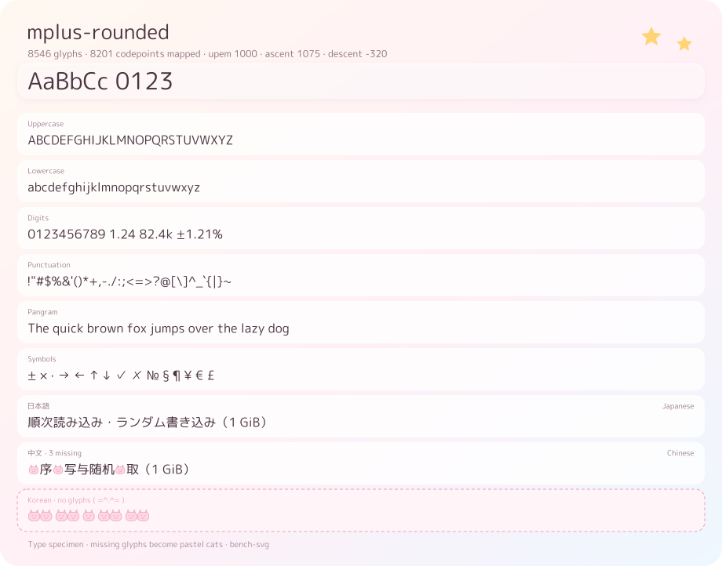

# bench-svg

Render benchmark results as a self-contained, pastel SVG card that belongs in a README.

No dashboard, no Pages branch, no JavaScript: one deterministic SVG file, with every label drawn from
real font outlines so GitHub can never substitute a different typeface.


## Why another benchmark chart

| | `bench-svg` | `github-action-benchmark` | CodSpeed / Bencher |
|---|---|---|---|
| Artifact | one committed SVG | HTML/Chart.js on gh-pages | hosted dashboard |
| Works in a README | yes | no (link only) | badge only |
| Font independent | outlines | viewer font | viewer font |
| Byte-identical reruns | yes | n/a | n/a |
| Same operation across sources | yes, one row per operation | no | separate series |
| Runtime | one static binary | Node action | SaaS |

## Install

```bash
cargo binstall bench-svg        # prebuilt binary
cargo install --path .          # from source
```

A TrueType/OpenType face is required. `fonts/` ships a small, OFL-only catalogue of rounded faces that
stay friendly without hurting legibility; pick one with `[font] family` or `--font`:

```bash
bench-svg render bench.jsonl -o assets/bench.svg --font quicksand
bench-svg render bench.jsonl -o assets/bench.svg --font-file MyFont.ttf
```

| Family | File | Covers | Size | Licence |
|---|---|---|---|---|
| Rounded M PLUS 1c (default) | `mplus-rounded.ttf` | Latin, Kana, JIS Kanji | 3.4 MB | OFL 1.1 |
| Quicksand | `quicksand.ttf` | Latin | 122 KB | OFL 1.1 |
| Nunito | `nunito.ttf` | Latin | 270 KB | OFL 1.1 |
| Sniglet | `sniglet.ttf` | Latin | 74 KB | OFL 1.1 |
| Comfortaa | `comfortaa.ttf` | Latin | 197 KB | OFL 1.1 |
| Zen Maru Gothic | `zen-maru-gothic.ttf` | Latin, Kana, JIS Kanji | 3.7 MB | OFL 1.1 |
| ZCOOL KuaiLe | `zcool-kuaile.ttf` | Latin, Simplified Chinese | 1.4 MB | OFL 1.1 |
| Gaegu | `gaegu.ttf` | Latin, Hangul | 3.0 MB | OFL 1.1 |

Every family ships its `-OFL.txt` next to the binary, and every family has a specimen card under
`assets/fonts/<file-stem>.svg`.

## Quick start

```bash
# Dart benchmark_test JSONL
bench-svg render bench-core.jsonl -o assets/bench.svg

# canonical JSON (any tool can emit this)
bench-svg render report.json -o assets/bench.svg

# CSV straight out of a spreadsheet
bench-svg render results.csv -o assets/bench.svg
```

## Input

`--format` accepts `auto` (default), `json`, `jsonl`, `csv`, `benchmark_test`, `criterion` and
`hyperfine`. Directories are walked recursively; `report/` folders (criterion's HTML output) are
skipped.

Importers read the tools' own output; nothing has to be converted first:

```bash
bench-svg render target/criterion -o assets/bench.svg --format criterion
bench-svg render bench.json -o assets/bench.svg --format hyperfine
```

- **criterion** — walks `target/criterion/**/new/estimates.json`, reads the sibling `benchmark.json`
  for `full_id` and `throughput`, and turns `Bytes`/`Elements` throughput into `B/s`/`ops/s`
  (`ns/op`, `direction: lower` otherwise). The 95 % confidence interval becomes the ±RME column.
- **hyperfine** — reads `--export-json` v2 (and the legacy v1 shape), using the wall-clock mean with
  `direction: lower`; seconds are formatted as ms/µs automatically.

Canonical shape, `bench-svg/report@1`:

```jsonc
{
  "schema": "bench-svg/report@1",
  "meta": {
    "tool": "benchmark_test",
    "tool_version": "0.9.1",
    "commit": "cd5cd87",
    "platform": { "os": "Windows", "arch": "x86_64", "cpu": "Ryzen 9 7950X", "cores": 32 }
  },
  "benchmarks": [{
    "id": "file.read.8MiB",          // stable key: matching, history, comparisons
    "group": "File I/O",
    "label": "Sequential read",      // display only
    "note": "8 MiB blocks · 1 GiB file",
    "unit": "B/s",                   // a dimension, not a decoration
    "value": 2254857830,
    "direction": "higher",           // "lower" for latency
    "params": { "block": "8MiB" },   // structured, never parsed out of names
    "stats": { "rme_pct": 1.21, "samples": 5 },
    "deterministic": false
  }]
}
```

Units carry a dimension (`B/s`, `IOPS`, `ns/op`, `instr`, `×`), so `2.10 GiB/s` and `1.24 ms` are
formatted from the data instead of hard-coded per row. Bars are scaled against the best value **inside
the same dimension**, and `direction: "lower"` inverts the bar so longer always means better.

## Gallery

| Figure | Shows |
|---|---|
| [`01-basic.svg`](assets/examples/01-basic.svg) | single source, mixed units, RME column |
| [`02-comparison.svg`](assets/examples/02-comparison.svg) | same operations, three platforms, legend, per-row values |
| [`03-units.svg`](assets/examples/03-units.svg) | `B/s`, `IOPS`, `ns/op`, `instr` formatted from their units |
| [`04-min-height.svg`](assets/examples/04-min-height.svg) | `min_height` keeps short cards the same height |
| [`05-dark.svg`](assets/examples/05-dark.svg) | `theme = "dark"` |
| [`06-max-rows.svg`](assets/examples/06-max-rows.svg) | `max_rows` truncation for a stable README height |
| [`07-dynamic-height.svg`](assets/examples/07-dynamic-height.svg) | height follows the number of rows |
| [`08-cjk.svg`](assets/examples/08-cjk.svg) | Japanese labels: outlines work for any script the font covers |
| [`09-notes.svg`](assets/examples/09-notes.svg) | notes and structured params on the second line |
| [`10-criterion.svg`](assets/examples/10-criterion.svg) | `--format criterion` straight from `target/criterion` |
| [`11-hyperfine.svg`](assets/examples/11-hyperfine.svg) | `--format hyperfine`, lower-is-better bars |
| [`12-rows.svg`](assets/examples/12-rows.svg) | `[[row]]` mapping: labels, units and `value * $1 * 32` |

Regenerate them with:

```bash
cargo run --example gallery            # SVGs into assets/examples/
cargo run --example gallery -- --png   # plus PNG previews in target/previews/
cargo run --example specimen           # one specimen card per font in fonts/
```

CI runs the same commands and fails if the committed SVGs are stale.

### Type specimens

Every font in `fonts/` also gets a specimen card in the same visual language: coverage per script,
metrics, and a pastel cat for every glyph the face cannot draw. A script with no coverage at all keeps
its row, marked with a dashed card, instead of silently disappearing. Non-Latin rows carry the script
name in English on the right, and the cat style — and therefore its size — is chosen from the ink of
the glyphs that row *can* draw, so dense CJK lines are not crowded by oversized placeholders.

[`assets/fonts/mplus-rounded.svg`](assets/fonts/mplus-rounded.svg)



## Config

`bench-svg.toml` is discovered from the working directory; `--config` overrides it.

```toml
[font]
family = "mplus-rounded"   # file stem inside ./fonts

[render]
title = "blit benchmarks"
subtitle = "{platform|local} · {tool} {tool_version} · commit {commit}"
footer = "Generated from {rows} rows"
width = 920
min_height = 0
theme = "pastel"          # or "dark"
kaomoji = "(◕‿◕)♡"
max_rows = 12

[[series]]
label = "Linux x64"
input = "bench-linux.jsonl"
color = "#7FD1B9"

[[series]]
label = "Windows x64"
input = "bench-windows.jsonl"
color = "#8CB8F0"
```

Two or more `[[series]]` switch the card to the comparison layout: one row per operation, one bar per
source, a legend, and one value per bar. Rows missing from a source render as an empty track and `—`.

### Row mapping

`[[row]]` replaces the hard-coded row table the Dart renderer used to have. Rules are applied in order;
matching rows take the rule's position in the card.

```toml
[[row]]
id = "file.read.8MiB"
label = "Sequential read"
note = "8 MiB blocks · 1 GiB file"

[[row]]
match = '^pool\.read\.random4K\.w(\d+)$'
label = "Pool read · $1 workers"
note = "4 KiB · batch 32"
value = "value * $1 * 32"    # arithmetic over `value` and captures
unit = "IOPS"
```

- `id` is an exact match; `match` is a regex whose groups become `$1`… in templates and values.
- `label`/`note` are templates: `$1` captures, `{param}` structured parameters. An empty `note`
  clears the note.
- `value` is a tiny safe expression: numbers, `value`, `$1`…, `+ - * /`, parentheses, and
  `min`/`max`/`abs`/`log10`/`sqrt`/`round`. No I/O and no host access, so a config arriving from a
  pull request is safe to evaluate.
- `only_matched = true` under `[render]` drops rows no rule matched; the default appends them.

### Placeholders

`{commit}`, `{commit:full}`, `{branch}`, `{tool}`, `{tool_version}`, `{tool:full}`, `{platform}`,
`{os}`, `{os_version}`, `{arch}`, `{cpu}`, `{cores}`, `{ram_gib}`, `{runner}`, `{rows}`, `{font}`.

Values come from the input document plus `GITHUB_SHA`, `RUNNER_OS` and `RUNNER_ARCH` when present.
Nothing reads the clock. `{key|fallback}` renders the fallback when the value is empty; `{{` is a
literal `{`.

## Determinism

Same inputs, same bytes — on every platform. That is what makes the artifact committable:

```bash
bench-svg render bench.jsonl -o assets/bench.svg
git diff --quiet -- assets/bench.svg || git commit -am "bench: refresh [skip ci]"
```

To keep that promise the renderer never reads the clock, never shells out to `git`, sorts every
collection, formats floats explicitly, uses software `libm` for logarithms, and hashes nothing.

## CI and releases

Two workflows:

- **`ci.yml`** — fmt, clippy, tests on Linux/macOS/Windows, regenerates the gallery and fails if the
  committed SVGs are stale, and renders the same input on all three systems to prove identical bytes.
- **`release.yml`** — runs on every push to `main`: verify → build six targets (musl, arm64, macOS,
  Windows) → regenerate and commit `assets/examples` with `[skip ci]` → **then** publish.

There are no semantic versions here; a release is identified by the date and the commit it was built
from, for example `v2026.10.19-cd5cd87`. Every archive is checksummed, attested with SLSA provenance,
and shipped with a `SHA256SUMS` file.

The gallery is committed on purpose: it is the visual contract. A rendering change that alters the
bytes must ship the new bytes in the same commit.

## GitHub Action

The action is a thin wrapper: it installs the right binary (cached, checksum-verified, with a
`tool_path` escape hatch for air-gapped runners) and runs one render. It never touches git, tokens or
pull-request comments — those stay ordinary steps in your workflow, so there is nothing to fight when
your repository's rules change.

```yaml
- uses: OWNER/bench-svg@v1
  id: bench
  with:
    input: target/criterion
    format: criterion
    out: assets/benchmarks.svg
    config: bench-svg.toml
    # version: v2026.10.19-cd5cd87   # optional pin
```

| Input | Default | Meaning |
|---|---|---|
| `input` | — | Files or directories, space or newline separated |
| `format` | `auto` | `auto`, `json`, `jsonl`, `csv`, `benchmark_test`, `criterion`, `hyperfine` |
| `config` | — | `bench-svg.toml` (auto-discovered when omitted) |
| `out` | `assets/benchmarks.svg` | Where to write the SVG |
| `font` | — | Family inside `./fonts`, e.g. `quicksand` |
| `font_file` | — | Explicit TTF/OTF instead of the catalogue |
| `version` | `auto` | Release tag; `auto` follows the action ref, else `latest` |
| `tool_path` | — | Use an existing binary, no download |

Outputs: `svg` (path) and `bytes` (size). The step summary records both.

`version: auto` never calls the GitHub API: if the action is pinned to a release tag it uses that tag,
otherwise it downloads `releases/latest/download/...`. Set `BENCH_SVG_RELEASE_BASE` to a mirror when
GitHub release downloads are slow.

Ready-made workflows live in [`templates/`](templates/):

- [`rust-criterion.yml`](templates/rust-criterion.yml) — `cargo bench`, then render and commit
- [`dart-benchmark-test.yml`](templates/dart-benchmark-test.yml) — `benchmark_test` JSONL
- [`hyperfine-matrix.yml`](templates/hyperfine-matrix.yml) — two runners merged into one comparison card

## Status

- [x] canonical input, JSONL (benchmark_test) and CSV
- [x] criterion and hyperfine importers
- [x] runtime TrueType metrics and outlines, parallel extraction with rayon
- [x] taffy layout, dynamic height, `min_height`, `max_rows`
- [x] multi-source comparison with legend
- [x] pastel and dark themes, font catalogue, type specimens
- [x] placeholder expansion
- [x] `[[row]]` mapping (labels, unit overrides, regex capture, value expressions)
- [x] reusable GitHub Action with a cached, checksum-verified binary
- [x] CI with a cross-platform identical-bytes gate
- [x] release pipeline with date+commit tags
- [ ] pytest / JMH / gungraun importers
- [ ] README-managed block and shields endpoint

## License

MIT OR Apache-2.0. The bundled fonts are under the SIL Open Font License 1.1; each `fonts/<name>-OFL.txt`
carries the original copyright notice.
